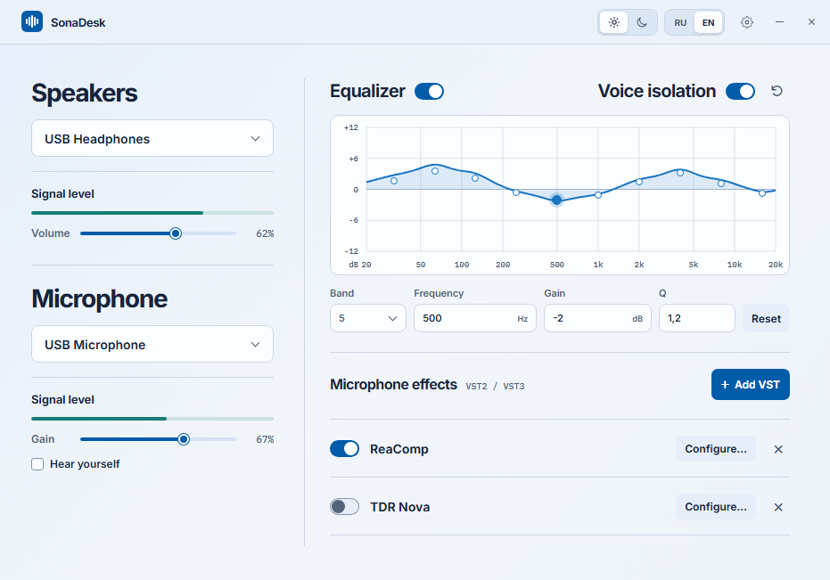

# SonaDesk

**English** · [Русский](README.ru.md)

Real-time microphone and speaker control for Windows.

**[Download SonaDesk for Windows](https://github.com/ekshenXV/sonadesk/releases/latest/download/SonaDesk.zip)**

Windows 10/11 x64 · .NET Framework 4.8

This build is unsigned. Windows 11 Smart App Control can block it from starting. [Microsoft's explanation](https://support.microsoft.com/en-us/windows/security/threat-malware-protection/smart-app-control-frequently-asked-questions)

## Features

- **Voice isolation** with before-and-after playback.
- **VST2 and VST3 microphone effects** with saved effect chains and plugin settings.
- **10-band parametric equalizer** for speakers and headphones.
- **Audio controls** for signal levels, output volume, microphone gain, and monitoring.

## Getting started

1. Download and extract the entire `SonaDesk.zip` archive.
2. Run `SonaDesk.exe` and select your devices.

Windows may request administrator access and briefly restart audio when connecting system effects for the first time.

## License

[MIT](LICENSE) · Copyright (c) 2026 [ekshenXV](https://github.com/ekshenXV). Third-party components retain their own licenses.

[Code signing policy](docs/development.md#code-signing-policy)
