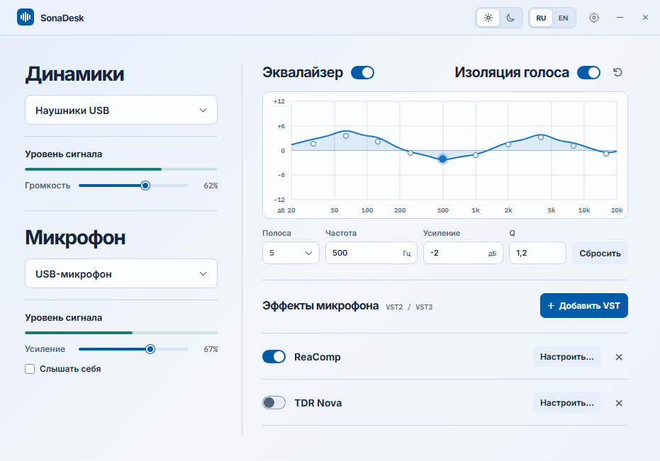

# SonaDesk

[English](README.md) · **Русский**

Настройка микрофона и динамиков в Windows в реальном времени.

**[Скачать SonaDesk для Windows](https://github.com/ekshenXV/sonadesk/releases/latest/download/SonaDesk.zip)**

Windows 10/11 x64 · .NET Framework 4.8

Эта сборка без цифровой подписи. «Интеллектуальное управление приложениями» в Windows 11 может блокировать её запуск. [Пояснение Microsoft](https://support.microsoft.com/ru-ru/windows/security/threat-malware-protection/smart-app-control-frequently-asked-questions)

## Возможности

- **Изоляция голоса** с прослушиванием записи до и после обработки.
- **VST2 и VST3 для микрофона** с сохранением цепочки и настроек ваших плагинов.
- **Параметрический эквалайзер на 10 полос** для динамиков и наушников.
- **Управление звуком** с индикаторами сигнала, регулировкой громкости и усиления и режимом «Слышать себя».

## Запуск

1. Скачайте и распакуйте `SonaDesk.zip` целиком.
2. Запустите `SonaDesk.exe` и выберите свои устройства.

При первом подключении системных эффектов Windows может запросить права администратора и ненадолго прервать звук.

## Лицензия

[MIT](LICENSE) · Copyright (c) 2026 [ekshenXV](https://github.com/ekshenXV). Сторонние компоненты сохраняют свои лицензии.

[Code signing policy](docs/development.md#code-signing-policy)
